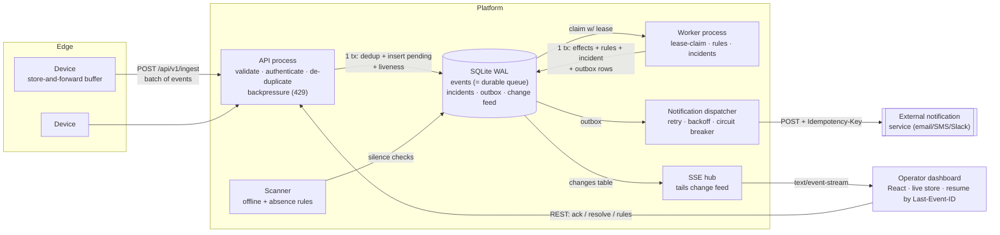

# Architecture notes

## 1. Interpreting the brief

The brief is deliberately vague, so I fixed these assumptions and designed against them:

| Question | Assumption |
|---|---|
| Scale | Hundreds to low thousands of devices, tens of events/sec sustained, bursts of thousands (offline replay). Not millions. |
| What does "accepted" mean? | **Durably stored.** After a 2xx the platform never loses the event. |
| Who is the user? | Operators who triage incidents, and care about *why* something fired as much as that it fired. |
| Time | Devices have unreliable clocks. "Silent" is judged on the **server** clock; "what happened when" on the **device** clock. |
| Deployment | Unspecified, so the system runs as a handful of small processes, with no infrastructure beyond a disk. |

## 2. System diagram

Data flow for one event: **device → `POST /ingest` → one transaction (validate, dedupe, store as `pending`, bump device liveness) → ack → worker claims with a lease → one transaction (update device state, evaluate rules, open/link incident, write decision log, write notification outbox rows, mark processed) → change feed → SSE → dashboard.** Notifications leave through a separate dispatcher reading the outbox.

## 3. Key decisions, alternatives, trade-offs

### Ingestion: HTTP batches (not MQTT / WebSocket / Kafka)
- **Chosen:** `POST /api/v1/ingest` with a batch of events, `Bearer` per-device key, per-event result in the response.
- **Why:** batching is exactly what offline replay needs; request/response gives an explicit ack, which is the foundation of the delivery guarantee. It works through every proxy and firewall, and is trivially testable with `curl`.
- **Alternatives:** MQTT is the natural fit for constrained devices and I would put it **in front of** this same ingest path in production (a bridge calling the same function). WebSockets add connection state for no gain here. Kafka solves a scale problem we don't have yet and costs real operational weight.

### Durable queue = the database (SQLite WAL), not Redis/RabbitMQ
- **Chosen:** the `events` table is both the store of record and the work queue (`pending → processing → processed | failed`).
- **Why:** this makes "accepted" and "queued" **one atomic fact**. There is no window where an event is acknowledged but exists only in a broker, and no dual-write to reconcile. Operationally it is zero extra services, and `docker compose up` works on a laptop.
- **Trade-off (honest):** SQLite has a single writer, which caps throughput (roughly low thousands of events/sec on this design, measured by the 6k burst in the lab) and confines the database to one host. The code talks to a thin set of SQL statements; the migration path is Postgres + `SELECT … FOR UPDATE SKIP LOCKED` for the claim, and the same lease/fencing logic carries over unchanged. I chose a smaller, reliable system I understand over a distributed one I can't justify.

### Effectively-once processing
Delivery is **at-least-once** at every hop; correctness comes from idempotency:

| Hop | Duplicate source | Defence |
|---|---|---|
| device → API | lost ack, retry | `UNIQUE(device_id, event_id)`; duplicate answered `duplicate`, never reprocessed |
| API → worker | crash after claim | lease expires → reclaim; all effects in **one transaction** so a half-processed event rolls back |
| worker ↔ worker | stalled worker's lease taken over | **fencing**: commit only succeeds `WHERE lease_owner = me`; a zombie's late commit is discarded |
| worker → notifier | crash after send, before mark | idempotency key `inc-<id>-v<version>-<kind>-<operator>` which the provider dedupes on |

### Incident de-duplication
At most **one unresolved incident per (rule, device)**, enforced by a partial unique index (`WHERE status != 'resolved'`), so even racing workers cannot violate it. Repeats link their event as evidence and bump `trigger_count` without re-notifying. A match within `cooldown_sec` of resolution **re-opens** the incident (anti-flapping) and re-notifies; later matches open a new one.

### Out-of-order and late events
- Rules evaluate events in **device-time order within a batch**; device "latest reading" only moves forward in device time.
- A replayed *normal* reading older than the breach does **not** clear a newer breach (`last_event_ts` guard). Covered by a test.
- Events are flagged `late` (delivered >30s after they happened) and `out_of_order`; incidents raised from replayed data are marked *detected late* with the delay in the summary.
- Events more than 5 minutes in the future (clock skew) or older than the retention window are rejected with a reason.

### Silence detection and the "who watches the watchers" problem
`last_seen_at` is the **server** time of the last authenticated request, written at **ingest**, not processing. So a backed-up worker can't make healthy devices look dead, and a drifting device clock can't either. If the API heartbeat is stale (platform was down), the scanner **suspends absence rules** and starts the silence window from when ingestion returned: a platform outage must not produce an alert storm.

### Real-time: SSE over a durable change feed (not WebSocket)
Every state change appends to a `changes` table; the API tails it and fans out over SSE with `id:` = change id. The browser reconnects with `Last-Event-ID` and the server **replays exactly what was missed**; if the gap is beyond retention, it signals `reset` and the client reloads a snapshot. SSE is one-directional (all we need), auto-reconnects natively, and traverses proxies. Because the feed lives in the DB, **multiple API replicas work** (each tails it) and API restarts lose nothing.

### Frontend resilience
Snapshot over REST + deltas over SSE (idempotent upserts by id); updates are coalesced per animation frame so an offline-replay burst doesn't re-render thousands of times; the last snapshot is cached in `localStorage` so a reload during an outage still shows *something*, clearly marked stale, with actions disabled; on reconnect it reports how many updates it caught up on.

### Rules: declarative, not scripts
Three kinds (threshold, absence, event-type) as validated JSON, with scope (type/location/device), severity, cooldown, auto-resolve. Evaluation is a **pure function** (unit-tested without I/O). Operators get a **dry-run** preview against the last hour of real traffic before saving. I chose not to embed an expression language: it is a large attack and support surface for a requirement the three kinds already cover.

### Notification routing
"Appropriate operator" = operators subscribe by **location** and **minimum severity** (`*` for the NOC). Rows are written to a transactional **outbox** in the same commit as the incident change, then delivered by a dispatcher with exponential backoff and a **circuit breaker** so a dead provider isn't hammered and retry budgets aren't burned. Failures never block event processing.

## 4. Guarantees and failure behaviour

| Failure | What happens | Guarantee |
|---|---|---|
| Same event delivered twice | Second copy acked as `duplicate`, ignored | Processed once |
| Event accepted, processing fails | Transaction rolls back; retry w/ exponential backoff + jitter; after 5 attempts → dead-letter (visible, re-queueable) | No partial state, no silent loss |
| Worker restarts / crashes | Lease expires (30s), event reclaimed; zombie commits fenced out | At-least-once → effectively-once |
| API restarts | Devices retry (they keep buffering); dashboards resume from `Last-Event-ID` | No lost events or UI updates |
| Notification service down | Incident still opens; outbox retries with backoff; breaker opens; delivered once on recovery (idempotency key) | At-least-once delivery, deduped by provider |
| Device offline minutes, then bursts | Buffer replays oldest-first in batches; stored with original timestamps; flagged late; absence incident auto-resolves | No data loss; late-detected incidents labelled |
| Ingestion > processing capacity | Backlog grows (visible); `/readyz` degrades; above the watermark → **429 + Retry-After** and devices keep buffering | Backpressure to the edge; no unbounded memory |
| Malformed payload | Rejected per event with reasons, stored in a debug table; rest of batch accepted | One bad event never poisons a batch |
| Browser loses connection | UI freezes on last known data, marked stale; resumes + catches up | No missed state |

## 5. Limitations (known and deliberate)

1. **Single-node database.** SQLite ⇒ one host, one writer. Migration path above. HA is not claimed.
2. **Device auth** is a per-device bearer key issued against a shared enrollment token. Production would use mTLS or signed JWTs with rotation/revocation UI.
3. **No operator authentication/RBAC** on the dashboard; "acting as" is an attribution aid, not security.
4. **Buffer overflow on the device** drops oldest events; the device reports a `buffer_overflow` event with the count, but those readings are gone.
5. **Absence rules** have ~`scanner interval` granularity (2s) and pause during a platform outage by design, which means a device that dies *during* a platform outage is detected one window late.
6. **Notification de-duplication is at the provider** via idempotency key: a provider ignoring the key could deliver twice after a crash at the worst moment.
7. **Retention** is time-based pruning of the change feed and decision log only; events and incidents are kept (production: partition/archive).
8. **Clock skew** tolerance is a fixed window; there is no per-device offset estimation.

## 6. What I would do next
Postgres + `SKIP LOCKED`; MQTT bridge; mTLS device identity; OIDC + RBAC; escalation policies (re-notify if unacknowledged after N minutes); rule versioning and audit log; per-device clock-offset estimation; OpenTelemetry traces across ingest → worker → notifier.
